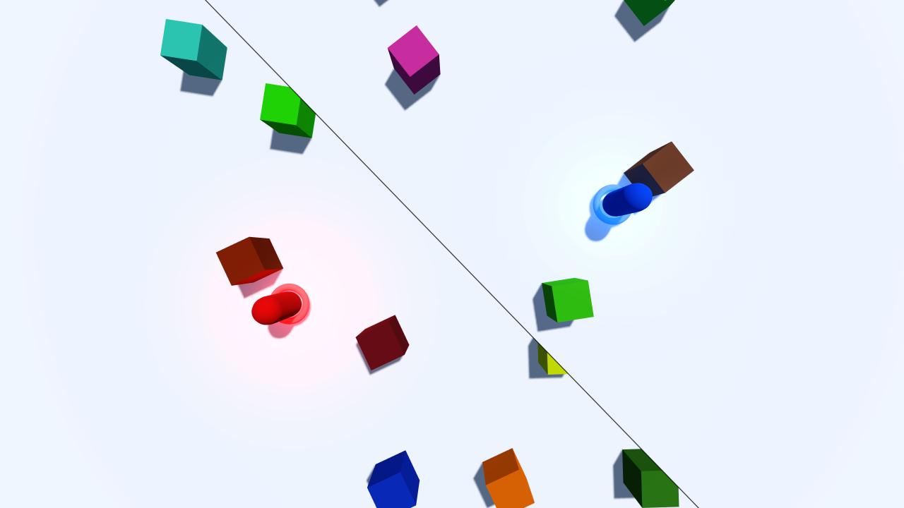
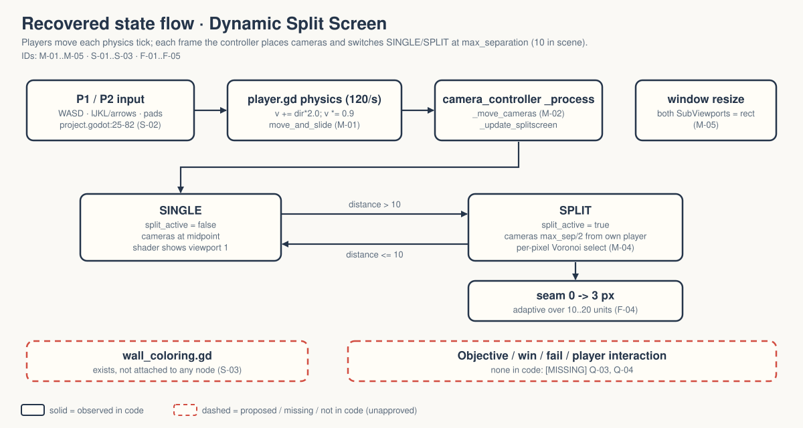

# walker-viewport-dynamic-split-screen — Game Design Document (recovered)

| | |
|---|---|
| Version | 0.1.0-recovered |
| Date | 2026-09-27 |
| Author | Zelda (agent, `/gdd reverse --path godot silent`), for Nik Bear Brown |
| Mode | recovered, silent |
| Revision | 1 |
| Gates | gate — unsigned at time of writing (vision ○ · systems ○ · world ○ · scope ○) |
| Source | `godot/` — Walker title-only copy of Godot demo `viewport/dynamic_split_screen`, commit `a3b5c113112f77291d5f3d1360f33a882fdc52f7` `[OBSERVED README.md:3-4]` |
| Engine | Godot 4.7.2 (logs), features "4.7", GL Compatibility, physics 120 ticks/s `[OBSERVED godot/project.godot:18,86,90-91]` |

Provenance tags: `[OBSERVED path:line]` the code or a file in this folder says this · `[INFERRED]` the code strongly implies it; evidence stated · `[MISSING]` nothing here can tell you; logged in `decisions.md`. Paths are relative to the folder root. Dashed elements in diagrams and deck are not in the code.

**What this document is.** A description of what exists, recovered from code. It is not an approved design. This project is a camera/shader tech demo with two movable players. It has movement and collision, which makes it look like the start of a game, but it has no goal, no win or fail state and no interaction between the players. Treat it as a demo.

*Upstream screenshot shipped with the Godot demo (`godot/screenshots/dynamic_split_screen.webp`, referenced by `godot/README.md:48`). Not a Walker capture: no shader pixels have been inspected in Walker `[OBSERVED FRICTIONAL.md:16]`.*

## 1. Vision summary

**What it is.** Two capsule "players" (P1 red, P2 blue) walk around a top-down arena of coloured wall blocks. When they are close, one camera shows both; when they separate past a threshold, the screen splits along a line perpendicular to the segment joining them (a "Voronoi" split). `[OBSERVED godot/README.md:12-34; godot/camera_controller.gd:1-19]`

**What it demonstrates.** Dynamic split screen implemented as two `SubViewport` cameras composited per pixel by a `canvas_item` shader. `[OBSERVED godot/README.md:22-30; godot/split_screen.gdshader]` The upstream README credits the idea's popularity to the Lego games `[OBSERVED godot/README.md:20]`.

**Why it exists in Walker.** `[MISSING]` The folder records a title-only adaptation with two native-4K Liam films pending `[OBSERVED README.md:8-10]`. Q-01.

**Player / audience.** `[MISSING]` Two local players can move, but nothing asks them to do anything. Implied audience: developers learning split-screen techniques `[INFERRED from godot/README.md "How it works"]`. Q-02.

**Fantasy, logline, promise.** Not applicable. `[MISSING]` by design; nothing here should be invented. Q-03.

## 2. Design pillars

`[MISSING]` None stated. Engineering properties the code protects, as inferences:

- **One screen while together, two when apart.** Split activates only past `max_separation` `[OBSERVED godot/camera_controller.gd:88-91]`.
- **The split follows the players, not the screen edges.** The line can take any angle `[OBSERVED godot/README.md:17-18; godot/split_screen.gdshader:27-57]`.
- **The seam eases in.** Line thickness grows from 0 as separation passes the threshold `[OBSERVED godot/camera_controller.gd:69-74]`.

## 3. Core loop

**Micro (every physics tick, 120/s).** Read the player's four move actions → add `direction × walk_speed` to velocity → multiply velocity by 0.9 (friction) → `move_and_slide()` `[OBSERVED godot/player.gd:9-22; godot/project.godot:86]`. With `walk_speed = 2.0` the steady-state speed works out to 0.9·2/0.1 = 18 units/s `[INFERRED arithmetic from player.gd:16-20]`; this is a tuning value, not approved design, and it is untested by a person.

**Every frame.** Place both cameras on the P1–P2 segment → decide split vs single → push player screen positions, split flag and line thickness to the shader `[OBSERVED godot/camera_controller.gd:45-82]`.

**Meso / macro.** None. There is no objective, round, score or end. `[OBSERVED absence]`

**Loop honesty test.** Strip the split screen: two capsules slide around walls with nothing to do. The movement is a means of driving the camera demo, not a game loop. `[INFERRED]`

## 4. Player Experience Goals

`[MISSING]` None; no PX-xx IDs assigned. A viewer goal ("both players always stay on screen, and the split reads as natural") is proposed in Q-02, not approved.

## 5. Mechanics

### M-01 Two-player movement `[OBSERVED]`
`player.gd` on two `CharacterBody3D`s, `player_id` 1 and 2 (`@export_range(1, 2)`), `walk_speed = 2.0` `[OBSERVED godot/player.gd:5-6; godot/split_screen.tscn:266-268,296-299]`. Capsule radius 0.375, height 1.75 `[OBSERVED godot/split_screen.tscn:32-34]`. Movement is on X/Z only; no jump, no gravity code `[OBSERVED godot/player.gd:16-17]`.

### M-02 Camera placement `[OBSERVED]`
Cameras sit on the P1–P2 segment: at the midpoint when separation ≤ `max_separation`, otherwise `max_separation / 2` from their own player toward the other `[OBSERVED godot/camera_controller.gd:50-61]`. Both cameras look straight down from y = 10 `[OBSERVED godot/split_screen.tscn:253-255,262-264]`. `max_separation` defaults to 20 in the script but the scene sets it to 10 `[OBSERVED godot/camera_controller.gd:21; godot/split_screen.tscn:237]`.

### M-03 Split activation `[OBSERVED]`
`split_active = horizontal distance > max_separation` (X/Z only) `[OBSERVED godot/camera_controller.gd:88-91,107-108]`. When inactive the shader shows viewport 1 across the whole screen `[OBSERVED godot/split_screen.gdshader:64-66]`.

### M-04 Voronoi composite and seam `[OBSERVED]`
The shader computes a line through screen centre perpendicular to the players' screen-space offset and chooses viewport 1 or 2 per pixel by which side of the line P1 is on; it draws an anti-aliased line in `split_line_color` `[OBSERVED godot/split_screen.gdshader:27-63]`. The distance-to-line helper carries its original attribution link `[OBSERVED godot/split_screen.gdshader:13-18]`. Thickness: `lerp(0, 3, (d − max)/max)` clamped to [0, 3] px when `adaptive_split_line_thickness` is true (default) `[OBSERVED godot/camera_controller.gd:22-24,69-76]`. The material's stored thickness of 10 is overwritten every frame `[OBSERVED godot/split_screen.tscn:29; godot/camera_controller.gd:81]`.

### M-05 Resize `[OBSERVED]`
On window resize both SubViewports take the visible-rect size and the shader receives it `[OBSERVED godot/camera_controller.gd:39,94-100]`.

## 6. Systems

### S-01 Scene composition `[OBSERVED]`
`split_screen.tscn` root `World3D` (Node3D): DirectionalLight3D (energy 0.05, shadows), WorldEnvironment (procedural sky, blue-tinted ambient), `Cameras` (Node3D + `camera_controller.gd`) holding `View` (full-rect TextureRect with the shader material) and `Viewport1/Camera1`, `Viewport2/Camera2`; `Player1`, `Player2` (mesh, collision, torus, coloured OmniLight3D, billboard `Label3D` "P1"/"P2"); `Ground` StaticBody3D; `Walls` with 7 groups × 6 StaticBody3D walls = 42, each mesh in group `walls` `[OBSERVED godot/split_screen.tscn:218-779]`.

### S-02 Input map `[OBSERVED godot/project.godot:25-82]`

| Player | Keyboard (physical) | Gamepad |
|---|---|---|
| P1 | W A S D | device 0, left stick (axes 0/1) |
| P2 | I J K L and arrow keys | device 0 right stick (axes 2/3) **and** device 1 left stick (axes 0/1) |

Device 0 drives both P1 (left stick) and P2 (right stick) `[OBSERVED same lines]`; whether that is intended (one-pad two-player) or legacy is `[MISSING]`, Q-09. No gamepad input has been verified in Walker `[OBSERVED FRICTIONAL.md:17]`.

### S-03 Unwired wall colouring `[OBSERVED]`
`wall_coloring.gd` (`@tool`, random colour per node in group `walls`) exists but is not attached to any node: `split_screen.tscn` references only `camera_controller.gd`, the shader, `icon.webp` and `player.gd` `[OBSERVED godot/wall_coloring.gd:1-13; godot/split_screen.tscn:3-6]`. A script without a scene is not a working feature. Q-08.

No save/load, scene transitions or named collision layers `[OBSERVED absence]`.

## 7. Progression

Not applicable. `[MISSING]` by design.

## 8. World

One flat arena: a ground plane and 42 wall blocks in seven groups `[OBSERVED godot/split_screen.tscn:328-779]`. Whether players can leave the walled area is untested `[OBSERVED FRICTIONAL.md:17 "collision routes … remain unverified"]`. No world rules.

## 9. Narrative

None; none invented. `[MISSING]` by design.

## 10. Characters

P1 (red light, red "P1" label) and P2 (blue light, blue "P2" label) are identical capsules distinguished only by colour and input `[OBSERVED godot/split_screen.tscn:282-294,314-326]`. No abilities, no personalities.

## 11. Features and priority

| ID | Feature | Status | Priority | Evidence |
|---|---|---|---|---|
| F-01 | Two-player keyboard movement | implemented; D and L key events move each player | CORE | `split-20260926.log` |
| F-02 | Camera placement on the P1–P2 segment | implemented; 5 static fixtures PASS | CORE | "camera fixture" ×5 |
| F-03 | Split activation + Voronoi shader composite | flag checked; shader pixels unverified | CORE | "split threshold fixture" ×5 |
| F-04 | Adaptive split-line thickness | implemented; 5 fixtures PASS | SUPPORTING | "adaptive thickness fixture" ×5 |
| F-05 | Resize both SubViewports | implemented; PASS | SUPPORTING | "both subviewports resize" |
| F-06 | Arena: ground + 42 walls with collision | implemented; routes unverified | SUPPORTING | S-01 |
| F-07 | P1/P2 colour lights and billboard labels | implemented | SUPPORTING | S-01 |
| F-08 | Gamepad bindings | configured; unverified | SUPPORTING | S-02 |
| F-09 | Random wall colouring (`wall_coloring.gd`) | script exists, **not attached** | SUPPORTING (not wired) | S-03 |
| F-10 | Headless diagnostic `test_split.gd` (Walker addition) | 18 assertions PASS | TOOLING | `split-20260926.log` |

**CORE: 3 of 10 = 30%**, under the 40% line.

## 12. Out of scope

Objectives, scoring, player interaction, more than two players, audio, menus. `[INFERRED from absence in godot/]` The Walker copy made no runtime change beyond the title and added a diagnostic `[OBSERVED FRICTIONAL.md:5-6]`.

## 13. Technical

- Scene: `godot/split_screen.tscn` (main, `godot/project.godot:17`). Scripts: `camera_controller.gd`, `player.gd`, `wall_coloring.gd` (unattached), `test_split.gd` (diagnostic). Shader: `split_screen.gdshader`. See `IMPLEMENTATION-MAP.md`.
- Assets: `icon.webp` only; all geometry and materials are built in-scene `[OBSERVED godot/split_screen.tscn:3-6]`. Maturity L2–L3 (greybox-level art, finished upstream code) `[INFERRED]`.
- Rendering: GL Compatibility, MSAA 3D ×2, directional soft-shadow quality 4 `[OBSERVED godot/project.godot:88-93]`. SubViewports: MSAA ×2, update mode 3 `[OBSERVED godot/split_screen.tscn:248-251,257-260]`.
- Verification on record: Godot 4.7.2 import and 120-frame runtime exit 0; `split-20260926.log` 18/18 PASS. The two movement checks are input-driven; the fifteen fixture checks disable player physics and set positions directly, so they are not gameplay or footage `[OBSERVED FRICTIONAL.md:8-14; godot/test_split.gd:33-44]`.
- Not verified: shader pixels, diagonal split orientation, seam appearance, collision routes, controller input, frame rate `[OBSERVED FRICTIONAL.md:16-17]`.

## 14. Risks

| ID | Risk | Likelihood | Impact | Mitigation |
|---|---|---|---|---|
| R-01 | Fixture checks read as gameplay proof | medium | a claim that the split "works" without anyone seeing a split | keep fixture wording; Q-05 |
| R-02 | Shader side-selection wrong at some angles | unknown | wrong player on wrong half; untested | GPU capture at several angles (T-08) |
| R-03 | 18 units/s steady speed feels too fast for a 10-unit split threshold | unknown | split flickers on and off during normal play | H-01 human session; Q-10 |
| R-04 | Someone assumes walls are randomly coloured | medium | film or text describes a feature that is not wired | Q-08 |
| R-05 | Gamepad device 0 drives both players | unknown | one controller moves both capsules | Q-09 |

## 15. Open questions

In `decisions.md`: Q-01 purpose, Q-02 audience, Q-03 demo or game, Q-04 player goal if it becomes a game, Q-05 visual acceptance, Q-06 film done, Q-07 CORE (under limit, recorded for completeness), Q-08 unattached wall colouring, Q-09 gamepad device 0 sharing, Q-10 movement feel.

## 16. Tests

Existing `[OBSERVED godot/test_split.gd]`, 18 PASS in `split-20260926.log`:

| ID | Check |
|---|---|
| T-01 | D key moves P1 in +X (input-driven, 24 physics frames) |
| T-02 | L key moves P2 in +X (input-driven) |
| T-03 | split flag at separations 0/10/15/20/5 equals `distance > 10` (static fixture) |
| T-04 | adaptive thickness at the same separations (static fixture) |
| T-05 | camera X positions at the same separations (static fixture) |
| T-06 | both SubViewports resize with the root |

Proposed (not written, not approved):

| ID | Check |
|---|---|
| T-07 | input-driven separation past 10 units flips `split_active` (replaces fixtures with play) |
| T-08 | GPU capture with players at 0°, 45°, 90° offsets; each half shows its own player (R-02) |
| T-09 | players cannot leave the arena along any wall gap (collision routes) |
| H-01 | two people play for two minutes and report split flicker or confusion (R-03) |

## Zelda's notes (silent mode; what I would have said out loud)

1. **Ghost Center — PRESENT, expected.** §1 "Why it exists in Walker" is `[MISSING]`. This is the one demo in the batch where somebody will be tempted to "just add a goal". Do not, unless Q-03 says it becomes a game; then run `/gdd v1` with a person.
2. **Mechanic Mirage — ABSENT by vacancy.**
3. **Implementation Void — PRESENT.** Only the happy path is covered: the split is tested with fixtures, not play, and the edge cases (players stacked vertically on screen, leaving the arena, one pad driving both) are undocumented.
4. **Priority Inflation — ABSENT.** 30% CORE.
5. **Novelist's Trap — ABSENT.** P1 and P2 have no lore; keep it that way.
6. **Completeness Fallacy — PRESENT.** The unattached `wall_coloring.gd` and the shared gamepad device looked like decisions and were not; now Q-08, Q-09.
7. **Stagnant Artifact — ABSENT.** Revision 1, CHANGELOG started.

**First fix:** T-07. Replace "the flag flips when I teleport the players" with "the flag flips when a person walks them apart". Everything visual waits on that.
